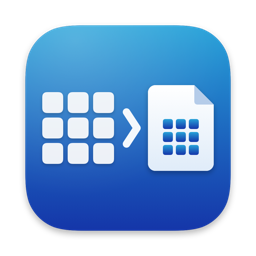
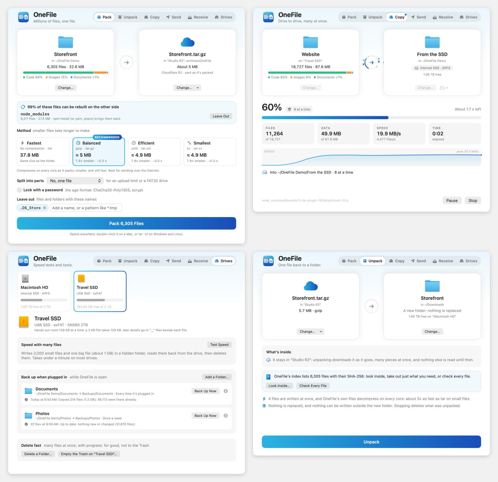

<p align="center">
  
</p>

<h1 align="center">OneFile</h1>

<p align="center">
  <b>Move a folder of millions of files in seconds, not days.</b><br>
  Pack it into one file, unpack it on every core, copy it to another drive many files at once, send
  it straight to another Mac, encrypted, or to the cloud as it's packed.
</p>

<p align="center">
  <picture>
    <source media="(prefers-color-scheme: dark)" srcset="docs/pack-dark.png">
    
  </picture>
</p>

Copying a folder with millions of small files is slow because of the files, not the bytes: every
file costs a lookup, an open, a read, a close and a few round trips, whatever its size. Finder's
Compress takes minutes and then you still have to move the archive; copying over the network takes
hours. OneFile does the per-file work once, as fast as the disk allows, and moves one stream instead.

- **Pack**: 300,000 small files and 3 GB of video into one file in **5.5 s**. Finder's Compress takes
  155 s on the same folder, and macOS's `tar` 114 s. Lock it with a password, split it into parts, or
  leave out what Git ignores.
- **Unpack**: about **3× as fast as `tar`** on small files, decompressing OneFile's own files on every
  core. Safe: it never replaces anything, and nothing can be written outside the new folder.
- **One file out of millions**: OneFile's archives carry an index (with every file's SHA-256) that
  other tools never see. Look inside at once, take out one file without unpacking the rest, or check
  every file.
- **Copy**: to another drive, 8 small files at a time while big files go one after another. Small
  files go onto a USB SSD **7× as fast as `ditto`** (13× `cp -R`) and back **9× as fast**. Stopped or
  unplugged, it picks up where it stopped; copied again, only what changed goes. It can read every
  copy back to check it, and compare two folders.
- **Back up when a drive is plugged in**: pick folders for a drive, and each time it's plugged in,
  what's new or changed goes to it. Even when OneFile isn't open, if you like.
- **The cloud**: pack straight to Amazon S3, Cloudflare R2, Backblaze B2, Google Cloud Storage, Wasabi
  or Google Drive, sent as it's packed. Unpack from there (or from any link) without downloading it
  first, take one file out of an archive in the cloud, and share a link.
- **Send and Receive**: send a folder straight to another Mac nearby. It's packed on one Mac and
  unpacked on the other at the same time, with no file in between, end-to-end encrypted, after both
  Macs confirm the same 6-digit code.
- **Drives**: how fast each drive really is with many small files, and deleting a folder of
  hundreds of thousands of files fast.
- **In Terminal too**: the `onefile` command does all of it from scripts.
- **Standard files**: `.tar`, `.tar.gz` and `.tar.xz`, which any Mac opens with a double-click and
  Linux and Windows with `tar -xf`, with nothing to install; and `.tar.zst` (zstd), smaller and
  quicker to make, for wherever OneFile or zstd is. Locked ones are [age](https://age-encryption.org)
  files.

<p align="center">
  <picture>
    <source media="(prefers-color-scheme: dark)" srcset="docs/tour-dark.png">
    
  </picture>
</p>

Requires macOS 14 (Sonoma) or later. Builds with Apple's free Command Line Tools: no Xcode, no
account.

## Why I built it

I deal with folders of millions of small files, and I wanted something that could move them around
fast: pack them, unpack them, copy them to a drive, send them to another Mac. I couldn't find anything
out there that did it (to be fair, I didn't look very hard), so I built this.

## Install

1. Install Apple's free Command Line Tools, if you haven't already:

   ```bash
   xcode-select --install
   ```

2. Build OneFile and put it in Applications:

   ```bash
   bash build.sh --install --open
   ```

Without `--install` the app stays in `build/`. It's signed ad hoc (no developer account needed), so for
another Mac, build it there the same way. Send and Receive need OneFile on both Macs, and macOS asks
once for permission to use the local network.

The `onefile` command is inside the app. To use it in Terminal, click **Install…** in OneFile's
Settings (⌘,), under In Terminal, which links it into `/usr/local/bin`, or do it yourself:

```bash
sudo ln -sf /Applications/OneFile.app/Contents/Helpers/onefile /usr/local/bin/onefile
```

## Use

OneFile has six parts, at the top of the window (⌘1 to ⌘6): Pack, Unpack, Copy, Send, Receive and
Drives. Each works the same way: what goes in on the left, where it ends up on the right, the choices
below, then the progress, then what happened. Packing, unpacking, copying and backing up can be
paused; anything can be stopped.

### Pack: a folder into one file

1. Drop a folder on the window (or on OneFile's Dock icon, or Control-click it in Finder › Services ›
   Pack with OneFile). OneFile counts it right away and shows what kinds of files it holds.
2. If it finds folders that can be rebuilt, like `node_modules`, it says how many files they are and
   offers to leave them out: `npm install` brings them back on the other side, and they're often most
   of a project's files. In a Git project, **Leave out what Git ignores** packs it as a clean checkout
   would have it, plus anything new.
3. Pick a **method**. Each shows its estimated size and time for this folder; one is Recommended.

   | Method        | File       | Speed, on an M4 Max           | macOS's /usr/share becomes | Opens without installing anything |
   |---------------|------------|-------------------------------|----------------------------|-----------------------------------|
   | **Fastest**   | `.tar`     | as fast as the disks          | 100%                       | Mac, Windows, Linux               |
   | **Balanced**  | `.tar.gz`  | about 1.3 GB/s, on every core | 37%                        | Mac, Windows, Linux               |
   | **Efficient** | `.tar.zst` | about 2.3 GB/s, on every core | 31%                        | Most Linux; elsewhere, OneFile or zstd |
   | **Smallest**  | `.tar.xz`  | about 55 MB/s, on every core  | 21%                        | Mac, Linux; on Windows, 7-Zip     |

   (Packing /usr/share, 534 MB in 19,270 files, one method after another. Efficient took 0.23 s,
   next to no compression's 0.22 s: reading the files is what holds it back. On text like source
   code the gap grows: the macOS SDK's framework headers, 290 MB, came to 11% of their size with
   Efficient and 19% with Balanced.)

4. If you like: **Split** it into parts (4 GB for a FAT32 drive, or whatever an upload takes:
   `Name.tar.gz.001`, `.002`…), or **Lock** it with a password. Locked, it's an
   [age](https://age-encryption.org) file (`Name.tar.gz.age`): scrypt for the password, ChaCha20-Poly1305
   for the data. OneFile asks for the password to unpack it; anywhere else, `age -d` opens it.
5. Add names to **leave out** (`.DS_Store` is there to begin with; patterns like `*.tmp` work), and
   **Pack**. You see both how much has been read and how much compressed and saved, the speed over
   time, and the time left. When it's done, drag the file anywhere or Share it (AirDrop, Mail…).

### Unpack: one file back into a folder

Drop a `.tar`, `.tar.gz`, `.tar.zst` or `.tar.xz` on the window (or Open With › OneFile, or Services ›
Unpack with OneFile). OneFile reads it through first, so before anything is written you see what's inside, how
much room it needs, and that it's intact. Then **Unpack**: it goes into a new folder next to the file
(or wherever you choose), named after the one folder inside, or after the file if there are several
things at its top. A name that's taken gets a number: nothing is ever replaced. A split file unpacks
from any of its parts; a locked one asks for its password.

It unpacks files from anything, not only OneFile: macOS's `tar` (its `._` Mac metadata files are left
out), GNU tar, Python, `gzip`, `xz`, `zstd`, and single compressed files (`notes.txt.gz` becomes
`notes.txt`).

**OneFile's own archives** carry an index after the end of the tar (where every other tool stops
reading, so they never see it; in a `.tar.zst`, in skippable frames that zstd itself passes over):
every entry, where it is, and each file's SHA-256, worked out while packing. With it, OneFile can:

- **Look inside** at once, and search, even in an archive of millions of files.
- **Take out** just the files or folders you pick, reading only the parts of the archive they're in
  (a compressed archive is made of blocks that can each be decompressed alone). Each file is checked
  against its SHA-256 as it comes out.
- **Check every file** against the SHA-256 it had when it was packed.

**From a link, or the cloud**: **Open a Link…** takes the address of an archive anywhere on the web,
and **From the Cloud…** lists the archives in your cloud accounts. Either is read straight from where
it is: unpacking downloads it as it goes (many pieces at once), and looking inside or taking one file
out reads only the pieces needed.

### Copy: to another drive, many files at once

<p align="center">
  <picture>
    <source media="(prefers-color-scheme: dark)" srcset="docs/copy-dark.png">
    
  </picture>
</p>

1. Choose the folder (the same one Pack and Send use) and where it goes: a drive from the list, or any
   folder. OneFile shows what each drive is (an SSD or a hard drive, how it's connected, its format)
   and how it will copy between them.
2. **Copy**. Small files go 8 at a time; big files one after another, in 8 MB pieces, the next read
   while the last is written. Reading from a hard drive, files go in the order they are on the disk.
   On one APFS drive, files are cloned: no time, and no extra space.
3. When it's done, it makes sure everything is on the drive, so it's safe to unplug, and offers to
   eject it.

- **Stopped, or unplugged?** A copy is made as "NAME (copying)" and gets its name only when complete.
  Copying again picks up where it stopped: files already there (same size and date) are skipped.
- **Copied before?** If a folder of that name is there, **Update It** copies only what's new or
  changed. Nothing at the destination is deleted unless you say so: with **Mirror**, OneFile lists
  what the copy has that the original no longer has, and moves it to the Trash if you ask.
- **Check it**: with **Verify**, every file copied is read back from the drive (not from memory) and
  checked against the SHA-256 worked out while copying. **Compare** (⇧⌘K) compares any two folders:
  names, sizes and dates, or every byte.
- **Thousands of files into a folder Dropbox, iCloud Drive, OneDrive, Google Drive or Box keeps in
  sync?** Each would be an upload of its own, which can take hours. OneFile says so and offers to
  pack them into one file instead: one upload.
- **Many small files for an exFAT drive?** Every file there takes at least a whole block (128 KB on a
  2 TB drive), so 20,000 files of 2 KB took 5.1 GB on one. OneFile says so and offers to **Pack
  Instead**: the same files as one 51 MB file, written in 0.4 s.
- It keeps what Finder keeps: permissions, modification and creation dates, the hidden flag, Finder
  tags and other extended attributes, hard links (where the drive can hold them), symbolic links.

### Send and Receive: Mac to Mac, no file in between

1. On the Mac that gets the folder, open OneFile and click **Receive**. While that screen is open, other
   Macs running OneFile on the same network can find it.
2. On the other Mac, click **Send**, choose the folder, and pick the Mac from the list.
3. Both Macs show the same 6-digit code. Confirm on both (**Codes Match, Send** on one, **Accept** on
   the other): that's what makes sure it's going to the right Mac and nobody is in between.
4. It's packed, encrypted and sent on one Mac while it's decrypted and unpacked on the other, on
   every core. Both show the progress, including how much has been unpacked at the other end.

Efficient (zstd) is a good choice for sending: it compresses more than Balanced, and faster. If the
other Mac's OneFile is too old to unpack zstd, it goes as Balanced, and the code screen says so.

If the Macs don't see each other (different networks, say), use **Connect by address…** with the
address the Receive screen shows, or pack to the cloud and send a link. To show this Mac under
another name: `defaults write local.onefile.app displayName "Studio"`.

### Drives: what each drive can do, and tools for it

- **Speed with many files**: writes 2,000 small files and one big file in a hidden folder, reads them
  back from the drive, then deletes them. You see small files a second in and out, the big file's
  speed, how much room a small file really takes, and what that means for copying there.
- **Back up when plugged in**: pick folders for a drive (**Add a Folder…**). Each time the drive is
  plugged in, what's new or changed in them is copied to a Backups folder on it, the way Copy updates
  a copy; nothing on the drive is deleted. Every time, once a day or once a week. While OneFile is open
  it shows the progress; with **Back up even when OneFile isn't open** (in Settings), a small
  background task does it, and its log is in `~/Library/Logs/OneFile/Backups.log`.
- **Delete fast**: a folder of hundreds of thousands of files (an old `node_modules`, a cache, a
  backup), or the drive's Trash, deleted for good, 8 files at a time, with progress. It won't touch the
  system, your home folder or a whole drive, and never crosses onto another drive.

### The cloud

Add accounts in Settings › Cloud:

| Service | What it needs |
|---------|---------------|
| Amazon S3 | A bucket, its region, and an access key allowed to list, read and write it |
| Cloudflare R2 | A bucket, your account ID, and an R2 API token's key |
| Backblaze B2 | A bucket, its region (from its endpoint), and an application key |
| Google Cloud Storage | A bucket, and an HMAC key (Settings › Interoperability) |
| Wasabi, MinIO and any other S3-compatible service | A bucket, the endpoint, and a key |
| Google Drive | A Google Cloud client of your own (a Desktop app OAuth client, with the Drive API on): OneFile has none to hand out. You sign in in the browser, and OneFile sees only the files it makes. |

Then, in Pack, **Change…** where it goes to an account. It's sent as it's packed: each piece goes up as
soon as it's written (four at once to S3), and the room it took on the disk is given back, so the disk
never holds much more than what's still to send, and it's done soon after packing is. When it's done,
**Copy Link** gives a link anyone can download it with: for 7 days at an S3 service, or for as long as
you leave it shared in Google Drive. Keys are kept in the Keychain.

### In Terminal

```bash
onefile pack ~/Projects/Research --method smallest --split 4GB
onefile pack ~/Projects/Research --to cloud:R2 --lock --link
onefile list Research.tar.gz
onefile extract Research.tar.gz 'data/*.csv' --to ~/Desktop
onefile unpack https://example.com/Research.tar.gz
onefile copy ~/Photos /Volumes/Travel --verify
onefile compare ~/Photos /Volumes/Travel/Photos --contents
onefile backup add ~/Documents /Volumes/Travel/Backups --every day
onefile speedtest /Volumes/Travel
onefile delete ~/old/node_modules
```

`onefile help` lists everything. Progress goes to standard error, results to standard output,
`--to -` packs to standard output for a pipe, a locked archive takes its password from
`ONEFILE_PASSWORD` if it's set, and `s3://BUCKET/KEY` works with Amazon's usual `AWS_ACCESS_KEY_ID`,
`AWS_SECRET_ACCESS_KEY`, `AWS_REGION` and `AWS_ENDPOINT_URL`. Control-C stops a job the way the
app's Stop does.

### Shortcuts and scripts

Links open OneFile set up for a job: `onefile://pack?folder=PATH` (with `&to=` a file or folder, and
`&method=fastest|balanced|smallest`), `onefile://unpack?file=PATH&to=FOLDER`,
`onefile://copy?folder=PATH&to=FOLDER`, `onefile://send?folder=PATH` and `onefile://receive`. With
`&start=1`, OneFile asks, then starts. Use them from Shortcuts (Open URLs), or `open "onefile://…"`.

### Settings

- **Work gently**: other apps get the disks first (the way Time Machine's reads and writes wait), and
  OneFile runs at a lower priority. Slower, but the Mac stays responsive.
- **Pause on battery**: packing, unpacking, copying and backing up pause when the Mac goes onto its
  battery, and carry on when it's back on power.
- **Backups**, **Cloud** accounts, and the **onefile** command.

## Speed

Packing a folder of 300,031 files (3.75 GB), uncompressed, on an M4 Max:

| Into one file with                                                      | Time      |
|-------------------------------------------------------------------------|-----------|
| Finder's Compress (`ditto -c -k`)                                       | 155 s     |
| `tar -cf`, as macOS ships it                                            | 114 s     |
| `zip -r -0` (no compression)                                            | 42 s      |
| `tar` with Mac metadata off (`--no-mac-metadata --no-xattrs --no-acls`) | 24 s      |
| **OneFile**                                                             | **5.5 s** |

Unpacking 100,200 files (410 MB: 100,000 small text files and 200 of 1 MB), on an M4 Max:

| File       | `tar -xf`, as macOS ships it | **OneFile** |
|------------|-----------------------------|-------------|
| `.tar`     | 6.7 s                       | **2.1 s**   |
| `.tar.gz`  | 6.7 s                       | **1.8 s**   |
| `.tar.xz`  | 7.1 s                       | **1.9 s**   |

Copying 20,000 small files (2 KB each, in 20 folders) between an M4 Max and a USB SSD (WD SN580,
exFAT, 10 Gb/s), one tool after another, the SSD's cached data dropped before each copy from it:

| Copy with   | Mac → SSD | SSD → Mac |
|-------------|-----------|-----------|
| `cp -R`     | 322 s     | 85 s      |
| `ditto`     | 173 s     | 40 s      |
| **OneFile** | **24 s**  | **4.6 s** |

Spotlight was indexing the SSD at the time, which slows every tool: on a quiet drive the same copy to
the SSD took `cp -R` 68 s and OneFile 10 s, and back, 21 s and 2 s. Then, to the SSD, OneFile makes sure
it's all on the drive, so it's safe to unplug (14 s more here, 7 s on a quiet drive), which Finder and
`cp` leave for when the drive is ejected. Big files go as fast as the connection allows: 1 GB in 16
files, 830 MB/s to the SSD and 900 MB/s back.

Deleting: 100,000 small files on the Mac's own SSD took `rm -rf` 4.1 s and OneFile 2.3 s; 20,000 on
the exFAT SSD, 12.4 s and 10.1 s (exFAT keeps every name in its folder's list, so each delete there
costs more, whoever does it).

Measure your own with `bash test.sh --pack FOLDER FILE`, `bash test.sh --unpack FILE FOLDER`,
`bash test.sh --copy FOLDER DESTINATION` and `onefile speedtest FOLDER`.

## How it's fast

**Packing.** OneFile lists each folder in bulk (`getattrlistbulk`, as Finder does), works out where every
file goes in the tar stream, then reads a thousand files at a time, sixteen at once, straight into their
places in memory, while the previous stretch is written. macOS keeps only about 263,000 files ready in
memory (`kern.maxvnodes`), so with millions of files every one comes from the disk, and reading many at
once is what hides the wait: 300,000 small files took 9.3 s reading 4 at a time and 4.7 s reading 16.
It writes plain POSIX pax itself, without the `._` Mac metadata entries that make macOS's own `tar`
slow.

**Compressing.** The tar stream is cut into blocks (4 MB for gzip, 8 MB for zstd, 16 MB for xz),
compressed on every core and written in order, like `pigz`, `pzstd` and `xz -T0`. Each block is a
complete gzip member, zstd frame or xz stream, which every reader takes as one stream. Each gzip member
says in its header how long it is (in an extra field other tools skip), and each zstd frame comes after
a 12-byte skippable frame that says how long it is, as `pzstd` writes them (so `pzstd` decompresses
OneFile's files on every core too): either way OneFile can find and decompress every block at once.
Each zstd frame also says how much it holds and carries a checksum. And each xz block carries a CRC32
of its data (Apple's encoder writes none, so damage would go unnoticed), so `xz -t` and OneFile can
check it. The same blocks are what let the index point into the middle of a compressed archive.

zstd is zstd's own library (1.5.7, by Meta, BSD-licensed), compiled from its source in `Vendor/zstd`
by `build.sh`: macOS doesn't come with it. gzip is macOS's zlib, and xz its Compression framework.

**Unpacking.** Decompression runs ahead on every core for OneFile's own files (and in order, on one
core, for anyone else's). Files are collected into batches straight from the decompressed data, and
each batch is written by four threads while the next is read: APFS makes small files fastest from
about four threads (on an M4 Max, 54,000 a second, against 20,000 from one, and slower again from
eight). Links, and folders' permissions and dates, are set last.

**Copying.** Finder and `cp` copy one file at a time, and every small file waits on both drives in
turn. OneFile copies 8 at a time: reading 20,000 small files from the USB SSD took 4.6 s one at a
time, 1.7 s four at a time, 1.1 s eight at a time, and 1.4 s sixteen. Big files go one at a time,
because exFAT drives are very slow at growing several files at once: four 64 MB files written together
took 51 s, one after another half a second. Two more things made a difference on exFAT, where macOS
keeps each file's Mac details (Finder tags, where it came from) in a `._` file beside it. Reading those
details through macOS re-reads the `._` file for every attribute, so OneFile reads each one once, as a
file (copying from the drive got 3.5× faster). And macOS's `copyfile` clears a copy's attributes before
writing them, which rewrites its `._` file, so OneFile copies only the attributes worth copying, as
Finder decides (copying to the drive got 2.3× faster).

**The cloud.** Packing writes a temporary file and the upload follows it: each piece is sent as soon as
it's complete, then punched out of the file (`F_PUNCHHOLE`), so the disk gives the room back at once.
Reading from the cloud asks for 2 MB pieces with range requests, 16 ahead of where reading has got to
when it reads in order, and only the pieces needed when it doesn't.

**Estimating.** While counting, OneFile keeps a random sample of 48 files, bigger ones more often (every
byte equally likely), compresses about 12 MB of them each way, and scales up. Big files stand for
themselves; each small one counts equally, using its own ratio within a flushed gzip stream, so a few
incompressible photos can't drown out thousands of text files. On the folders tried, the Balanced
estimate was within about 5% of the real size; the Smallest estimate errs on the large side.

## Security

**Unpacking** never replaces anything and never writes outside the new folder:

- Everything goes into a new "NAME (unpacking)" folder, renamed only when complete, with
  `renamex_np(RENAME_EXCL)` and a number if the name is taken. Stopping or failing deletes it.
- Paths with `..` are refused, and absolute paths are made relative.
- Every file is opened with `O_NOFOLLOW_ANY`, so no link in its path is followed. Symbolic links are
  made last, inside folders opened the same way, and hard links only to paths inside the folder.
- Damage is caught: tar headers' checksums, gzip's CRC on every member, zstd's checksum on every
  frame, and xz's check. Taking files out of OneFile's archives checks each against its SHA-256.

**Locking** is the age format, so it isn't OneFile's own invention, and any age tool opens it: the
password is stretched with scrypt (N = 2¹⁸, a second or so), and the data is sealed with
ChaCha20-Poly1305 in 64 KB pieces, so a piece changed, dropped or moved fails to open. The tests check
that an independent age reader (written from the spec in plain Python) opens what OneFile locks.

**Sending** is end-to-end encrypted, and nothing is sent until both Macs confirm:

- The Macs agree a key with X25519. The sender first commits to its key (sends its SHA-256), so
  someone in the middle can't choose keys after seeing the real ones to make the codes match.
- From the shared secret and everything said so far, both work out the 6-digit code (HKDF and HMAC
  with SHA-256). Someone in the middle, or a Mac pretending to be the one you picked, would show a
  different code, and gets a one-in-a-million guess. Both sides must confirm before anything is sent.
- Everything after is AES-256-GCM, with a key for each direction and a counter in every nonce: a block
  changed, dropped, repeated or moved fails to decrypt, and the transfer stops.
- The receiving Mac unpacks with all the protections above, and makes the folder name it's sent safe.
- A Mac can be found only while its Receive screen is open, and gets nothing unless someone accepts.

What it can't hide is how much is sent, and when. And the codes only help if you compare them.

**Copying and backing up** never delete anything at the destination (Mirror only moves to the Trash
what you agree to), and never write outside the copy:

- It refuses to copy a folder into itself, or update the folder it's copying from.
- Every file is opened with `O_NOFOLLOW_ANY`, and folders are made inside folders opened the same way,
  so a link at the destination can't send a file elsewhere. Symbolic links are made last.
- Updating replaces only files that changed in the original (an older version by the same name); a
  folder is never replaced with a file.

**The cloud**: keys and sign-ins are kept in the Keychain, never in a file. Requests are signed with
AWS Signature Version 4 (checked against Amazon's own examples) and go over HTTPS. Google Drive is
asked only for `drive.file`: OneFile sees the files it makes, nothing else in the Drive. Signing in
uses PKCE, with Google sending the browser back to OneFile on 127.0.0.1. Lock an archive before
sending it if the cloud shouldn't see what's in it.

## Also

- **Finder**: Control-click a folder or a tar file › Services › Pack, Send or Unpack with OneFile (turn
  them on in System Settings › Keyboard › Keyboard Shortcuts › Services if they're not there). Tar
  files list OneFile under Open With; folders and files can be dropped on its Dock icon.
- **Dock**: while it works, a progress bar on OneFile's Dock icon.
- **iCloud**: files that are only in iCloud are left out rather than downloaded, and counted.
- **Keyboard**: ⌘1 to ⌘6 for the six parts, ⌘O to choose a folder, ⇧⌘O a file to unpack, ⇧⌘K to
  compare two folders, ⌘↩ to go, ⌘. to stop.

On the other side without OneFile:

- **Mac**: double-click the file, or `tar -xf Research.tar.gz` in Terminal.
- **Windows 10 or 11**: `tar -xf Research.tar.gz` (for `.tar` and `.tar.gz`); for `.tar.xz`, 7-Zip.
- **Linux**: `tar -xf Research.tar.gz`, and `tar -xf Research.tar.zst` where zstd is installed (most
  have it).
- **`.tar.zst` on a Mac**: install zstd (`brew install zstd`), then `tar -xf Research.tar.zst`.
- **Split**: `cat Research.tar.gz.* | tar -xf -`. **Locked**: `age -d Research.tar.gz.age | tar -xf -`.

What goes in the file: files, folders, permissions, dates, symbolic links, named pipes and hard links (a
file with several names goes in once), with long and non-ASCII names, files over 8 GB and dates before
1970 stored the standard way. Not Mac-only extras (extended attributes, Finder tags, ACLs), which
other systems ignore anyway; not other disks mounted inside the folder, sockets or devices.

## Tests

```bash
bash test.sh
```

checks that OneFile and the `onefile` command compile cleanly in Swift 6's strict mode, then runs
over 500 checks:

- **Packing**: a folder with everything a tar file has to get right (long and non-ASCII names, empty
  and big files, both kinds of links, a named pipe, odd permissions and dates, unreadable items, names
  to leave out), for each method. Each pack is unpacked with macOS's own `tar` and compared byte for
  byte, and read with Python's `tarfile`; `.tar.zst` also with `zstd` (`-t`, and `-l`, which counts
  its frames) and `pzstd`. Split, locked, and with what Git ignores left out. An index of over a
  million files.
- **Unpacking**: OneFile's own files, files made by macOS's `tar`, `gzip`, `xz` (one block and many),
  `zstd` (one frame, one with a 128 MB window from a pipe, and `pzstd`'s many) and Python (GNU and pax
  formats, gzip and zstd), and single compressed files, each compared exactly with the original. The
  index: listing, taking files out, checking, and damage found.
- **Locking**: scrypt against RFC 7914's examples, wrong passwords, damage, and an independent age
  reader in Python opening what OneFile locks.
- **Attacks and damage**: `..` paths, absolute paths, links that would be written through, links
  inside links, damaged and cut-off files. It also checks that stopping leaves nothing behind.
- **Sending**: the encryption (moved, changed or lying blocks don't open), and a real send and receive
  over loopback for each method, with both sides' codes compared and the result checked file by file;
  and Efficient sent to a OneFile that can't unpack zstd, going as Balanced.
- **Copying**: on one drive (clones), to another APFS drive and to an exFAT one (disk images `test.sh`
  makes) and back, compared exactly, creation dates and attributes included; in disk order; updating;
  stopping and picking up; verifying and mirroring; a link at the destination that would be written
  through; and `._` files. Comparing folders, the speed test, and deleting.
- **Backups**: what's due when, and backing up to a disk image, updating, never deleting.
- **The cloud**: request signing against Amazon's published examples, Google's sign-in against RFC
  7636's, and a small S3 server in the tests that checks every request's signature: packing to it as
  it packs (in many pieces), listing, reading the index and taking one file out with range requests,
  unpacking from it and from a link, a locked archive, stopping half way, and a wrong key.
- **The command**: every command run as a program, with its output and exit status checked.
- **Smaller things**: the size estimates, the insights, not replacing files, and packing twice giving
  the same bytes.

To time your own folders and files:

```bash
bash test.sh --pack ~/Projects/Research /tmp/Research.tar.gz gzip
```

```bash
bash test.sh --unpack /tmp/Research.tar.gz /tmp/unpacked
```

```bash
bash test.sh --inspect /tmp/Research.tar.gz
```

```bash
bash test.sh --estimate ~/Projects/Research
```

```bash
bash test.sh --copy ~/Projects/Research /Volumes/MyDrive
```

## Inside

| File | What it does |
|------|--------------|
| `Packer.swift`, `FolderReader.swift`, `Tar.swift` | Listing folders in bulk, and packing them into a tar stream |
| `Compressor.swift`, `Method.swift`, `Estimator.swift` | Compressing on every core, the four methods, and their estimates |
| `Unpacker.swift`, `Decoders.swift`, `Zstd.swift` | Reading tar, gzip, zstd and xz (in parallel where it can), and unpacking safely |
| `Index.swift`, `Extract.swift` | OneFile's index, taking files out, and checking every file |
| `Age.swift` | Locking with a password: the age format, scrypt, ChaCha20-Poly1305 |
| `Copier.swift`, `Comparer.swift`, `Drives.swift`, `AppleDouble.swift` | Copying between drives, comparing folders, what each drive is, and reading `._` files |
| `Backups.swift` | Backing up to drives when they're plugged in, and the background agent |
| `Remote.swift`, `S3.swift`, `GoogleDrive.swift`, `Cloud.swift` | Reading archives on the internet, S3 and Google Drive, and packing to the cloud |
| `SpeedTest.swift`, `Deleter.swift`, `Git.swift`, `Work.swift` | Drive speed, deleting fast, what Git ignores, working gently and pausing |
| `Transfer.swift`, `Nearby.swift` | The encrypted protocol, sending and receiving, and finding Macs with Bonjour |
| `Insights.swift` | Kinds of files, and folders that can be rebuilt |
| `CLI/main.swift` | The `onefile` command, built from the same files minus the windows |
| `*Model.swift`, `*View.swift`, `Components.swift`, `Effects.swift`, `Theme.swift` | The app (SwiftUI) |

`Vendor/zstd` is zstd's library, unchanged (see its README for where it came from); `Tools/zstd.sh`
compiles it. The app icon is drawn by `swift Tools/make-icon.swift`.

## What's next

Sending to and from phones, tablets and other computers, from their web browser with nothing to
install: see [ROADMAP.md](ROADMAP.md).

## License

MIT: see [LICENSE](LICENSE). The zstd library in `Vendor/zstd` is Meta's, under the BSD license: see
[Vendor/zstd/LICENSE](Vendor/zstd/LICENSE).
