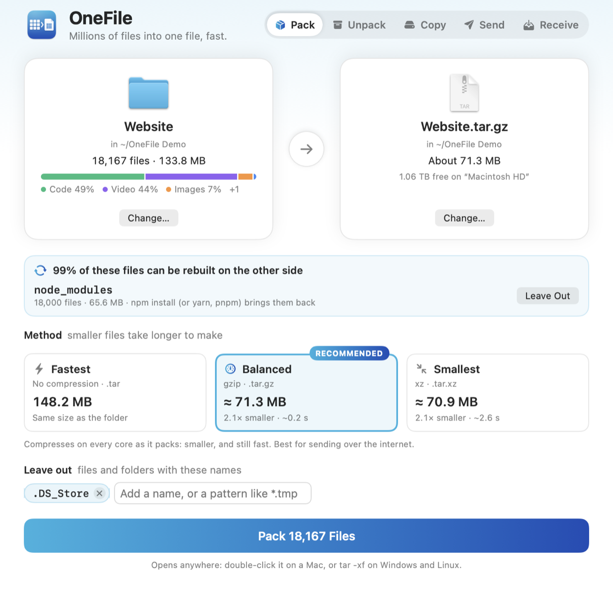
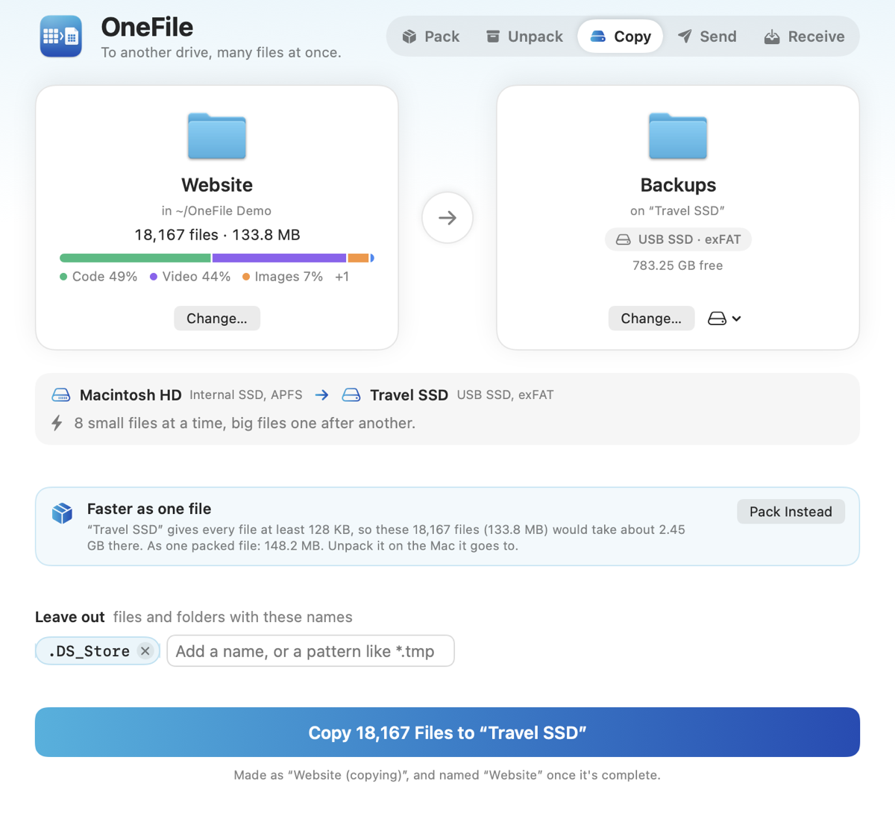

<p align="center">
  
</p>

<h1 align="center">OneFile</h1>

<p align="center">
  <b>Move a folder of millions of files in seconds, not days.</b><br>
  Pack it into one file, unpack it on every core, copy it to another drive many files at once, or
  stream it straight to another Mac, encrypted.
</p>

<p align="center">
  <picture>
    <source media="(prefers-color-scheme: dark)" srcset="docs/pack-dark.png">
    
  </picture>
</p>

Copying a folder with millions of small files is slow because of the files, not the bytes: every
file costs a lookup, an open, a read, a close and a few round trips, whatever its size. Finder's
Compress takes minutes and then you still have to move the archive; copying over the network takes
hours. OneFile does the per-file work once, as fast as the disk allows, and moves one stream instead.

- **Pack**: 300,000 small files and 3 GB of video into one file in **5.5 s**. Finder's Compress takes
  155 s on the same folder, and macOS's `tar` 114 s.
- **Unpack**: about **3× as fast as `tar`** on small files, decompressing OneFile's own files on every
  core. Safe: it never replaces anything, and nothing can be written outside the new folder.
- **Copy**: to another drive, 8 small files at a time while big files go one after another. Small
  files go onto a USB SSD **7× as fast as `ditto`** (13× `cp -R`) and back **9× as fast**. It knows
  each drive (SSD or hard drive, USB or Thunderbolt, exFAT or APFS) and copies the way that's fastest
  between them. Stopped or unplugged, it picks up where it stopped; copied again, only what changed
  goes.
- **Send and Receive**: send a folder straight to another Mac nearby. It's packed on one Mac and
  unpacked on the other at the same time, with no file in between, end-to-end encrypted, after both
  Macs confirm the same 6-digit code.
- **Smart about what's inside**: what kinds of files a folder holds, how big each method's file would
  be (measured on a sample, in under a second), which method to use, and which folders can simply
  be rebuilt on the other side (`node_modules`, Python caches, Xcode's DerivedData…), with a button
  to leave them out.
- **Standard files**: `.tar`, `.tar.gz` and `.tar.xz`. Double-click one on any Mac, or run `tar -xf`
  on Linux and Windows. Nothing to install on the other side.

<p align="center">
  <picture>
    <source media="(prefers-color-scheme: dark)" srcset="docs/tour-dark.png">
    
  </picture>
</p>

Requires macOS 14 (Sonoma) or later. Builds with Apple's free Command Line Tools: no Xcode, no
account.

## Why I built it

I deal with folders of millions of small files, and I wanted something that could move them around
fast: pack them, unpack them, copy them to a drive, send them to another Mac. I couldn't find anything
out there that did it (to be fair, I didn't look very hard), so I built this.

## Install

1. Install Apple's free Command Line Tools, if you haven't already:

   ```bash
   xcode-select --install
   ```

2. Build OneFile and put it in Applications:

   ```bash
   bash build.sh --install --open
   ```

Without `--install` the app stays in `build/`. It's signed ad hoc (no developer account needed), so for
another Mac, build it there the same way. Send and Receive need OneFile on both Macs, and macOS asks
once for permission to use the local network.

## Use

OneFile has five parts, at the top of the window (⌘1 to ⌘5). Each works the same way: what goes in on
the left, where it ends up on the right, the choices below, then the progress, then what happened.

### Pack: a folder into one file

1. Drop a folder on the window (or on OneFile's Dock icon, or Control-click it in Finder › Services ›
   Pack with OneFile). OneFile counts it right away and shows what kinds of files it holds.
2. If it finds folders that can be rebuilt, like `node_modules`, it says how many files they are and
   offers to leave them out: `npm install` brings them back on the other side, and they're often most
   of a project's files.
3. Pick a **method**. Each shows its estimated size and time for this folder; one is Recommended.

   | Method       | File      | Speed, on an M4 Max          | macOS's /usr/share becomes | Opens without installing anything |
   |--------------|-----------|------------------------------|----------------------------|-----------------------------------|
   | **Fastest**  | `.tar`    | as fast as the disks         | 100%                       | Mac, Windows, Linux               |
   | **Balanced** | `.tar.gz` | about 1.6 GB/s, on every core | 37%                       | Mac, Windows, Linux               |
   | **Smallest** | `.tar.xz` | about 60 MB/s, on every core | 20%                        | Mac, Linux; on Windows, 7-Zip     |

4. Add names to **leave out** (`.DS_Store` is there to begin with; patterns like `*.tmp` work), and
   **Pack**. You see both how much has been read and how much compressed and saved, the speed over
   time, and the time left. When it's done, drag the file anywhere or Share it (AirDrop, Mail…).

### Unpack: one file back into a folder

Drop a `.tar`, `.tar.gz` or `.tar.xz` on the window (or Open With › OneFile, or Services › Unpack with
OneFile). OneFile reads it through first, so before anything is written you see what's inside, how
much room it needs, and that it's intact. Then **Unpack**: it goes into a new folder next to the file
(or wherever you choose), named after the one folder inside, or after the file if there are several
things at its top. A name that's taken gets a number: nothing is ever replaced.

It unpacks files from anything, not only OneFile: macOS's `tar` (its `._` Mac metadata files are left
out), GNU tar, Python, `gzip`, `xz`, and single compressed files (`notes.txt.gz` becomes `notes.txt`).

### Copy: to another drive, many files at once

<p align="center">
  <picture>
    <source media="(prefers-color-scheme: dark)" srcset="docs/copy-dark.png">
    
  </picture>
</p>

1. Choose the folder (the same one Pack and Send use) and where it goes: a drive from the list, or any
   folder. OneFile shows what each drive is (an SSD or a hard drive, how it's connected, its format)
   and how it will copy between them.
2. **Copy**. Small files go 8 at a time; big files one after another, in 8 MB pieces, the next read
   while the last is written. Reading from a hard drive, files go in the order they are on the disk.
   On one APFS drive, files are cloned: no time, and no extra space.
3. When it's done, it makes sure everything is on the drive, so it's safe to unplug, and offers to
   eject it.

- **Stopped, or unplugged?** A copy is made as "NAME (copying)" and gets its name only when complete.
  Copying again picks up where it stopped: files already there (same size and date) are skipped.
- **Copied before?** If a folder of that name is there, **Update It** copies only what's new or
  changed. Nothing at the destination is ever deleted.
- **Many small files for an exFAT drive?** Every file there takes at least a whole block (128 KB on a
  2 TB drive), so 20,000 files of 2 KB took 5.1 GB on one. OneFile says so and offers to **Pack
  Instead**: the same files as one 51 MB file, written in 0.4 s.
- It keeps what Finder keeps: permissions, modification and creation dates, the hidden flag, Finder
  tags and other extended attributes, hard links (where the drive can hold them), symbolic links.

### Send and Receive: Mac to Mac, no file in between

1. On the Mac that gets the folder, open OneFile and click **Receive**. While that screen is open, other
   Macs running OneFile on the same network can find it.
2. On the other Mac, click **Send**, choose the folder, and pick the Mac from the list.
3. Both Macs show the same 6-digit code. Confirm on both (**Codes Match, Send** on one, **Accept** on
   the other): that's what makes sure it's going to the right Mac and nobody is in between.
4. It's packed, encrypted and sent on one Mac while it's decrypted and unpacked on the other, on
   every core. Both show the progress, including how much has been unpacked at the other end.

If the Macs don't see each other (different networks, say), use **Connect by address…** with the
address the Receive screen shows. To show this Mac under another name:
`defaults write local.onefile.app displayName "Studio"`.

## Speed

Packing a folder of 300,031 files (3.75 GB), uncompressed, on an M4 Max:

| Into one file with                                                      | Time      |
|-------------------------------------------------------------------------|-----------|
| Finder's Compress (`ditto -c -k`)                                       | 155 s     |
| `tar -cf`, as macOS ships it                                            | 114 s     |
| `zip -r -0` (no compression)                                            | 42 s      |
| `tar` with Mac metadata off (`--no-mac-metadata --no-xattrs --no-acls`) | 24 s      |
| **OneFile**                                                             | **5.5 s** |

Unpacking 100,200 files (410 MB: 100,000 small text files and 200 of 1 MB), on an M4 Max:

| File       | `tar -xf`, as macOS ships it | **OneFile** |
|------------|-----------------------------|-------------|
| `.tar`     | 6.7 s                       | **2.1 s**   |
| `.tar.gz`  | 6.7 s                       | **1.8 s**   |
| `.tar.xz`  | 7.1 s                       | **1.9 s**   |

Copying 20,000 small files (2 KB each, in 20 folders) between an M4 Max and a USB SSD (WD SN580,
exFAT, 10 Gb/s), one tool after another, the SSD's cached data dropped before each copy from it:

| Copy with   | Mac → SSD | SSD → Mac |
|-------------|-----------|-----------|
| `cp -R`     | 322 s     | 85 s      |
| `ditto`     | 173 s     | 40 s      |
| **OneFile** | **24 s**  | **4.6 s** |

Spotlight was indexing the SSD at the time, which slows every tool: on a quiet drive the same copy to
the SSD took `cp -R` 68 s and OneFile 10 s, and back, 21 s and 2 s. Then, to the SSD, OneFile makes sure
it's all on the drive, so it's safe to unplug (14 s more here, 7 s on a quiet drive), which Finder and
`cp` leave for when the drive is ejected. Big files go as fast as the connection allows: 1 GB in 16
files, 830 MB/s to the SSD and 900 MB/s back.

Measure your own with `bash test.sh --pack FOLDER FILE`, `bash test.sh --unpack FILE FOLDER` and
`bash test.sh --copy FOLDER DESTINATION`.

## How it's fast

**Packing.** OneFile lists each folder in bulk (`getattrlistbulk`, as Finder does), works out where every
file goes in the tar stream, then reads a thousand files at a time, sixteen at once, straight into their
places in memory, while the previous stretch is written. macOS keeps only about 263,000 files ready in
memory (`kern.maxvnodes`), so with millions of files every one comes from the disk, and reading many at
once is what hides the wait: 300,000 small files took 9.3 s reading 4 at a time and 4.7 s reading 16.
It writes plain POSIX pax itself, without the `._` Mac metadata entries that make macOS's own `tar`
slow.

**Compressing.** The tar stream is cut into blocks (4 MB for gzip, 16 MB for xz), compressed on every
core and written in order, like `pigz` and `xz -T0`. Each block is a complete gzip member or xz stream,
which every reader takes as one stream. Two additions: each gzip member says in its header how long
it is (in an extra field other tools skip), so OneFile can find and decompress every member at once;
and each xz block carries a CRC32 of its data (Apple's encoder writes none, so damage would go
unnoticed), so `xz -t` and OneFile can check it.

**Unpacking.** Decompression runs ahead on every core for OneFile's own files (and in order, on one
core, for anyone else's). Files are collected into batches straight from the decompressed data, and
each batch is written by four threads while the next is read: APFS makes small files fastest from
about four threads (on an M4 Max, 54,000 a second, against 20,000 from one, and slower again from
eight). Links, and folders' permissions and dates, are set last.

**Copying.** Finder and `cp` copy one file at a time, and every small file waits on both drives in
turn. OneFile copies 8 at a time: reading 20,000 small files from the USB SSD took 4.6 s one at a
time, 1.7 s four at a time, 1.1 s eight at a time, and 1.4 s sixteen. Big files go one at a time,
because exFAT drives are very slow at growing several files at once: four 64 MB files written together
took 51 s, one after another half a second. Two more things made a difference on exFAT, where macOS
keeps each file's Mac details (Finder tags, where it came from) in a `._` file beside it. Reading those
details through macOS re-reads the `._` file for every attribute, so OneFile reads each one once, as a
file (copying from the drive got 3.5× faster). And macOS's `copyfile` clears a copy's attributes before
writing them, which rewrites its `._` file, so OneFile copies only the attributes worth copying, as
Finder decides (copying to the drive got 2.3× faster).

**Estimating.** While counting, OneFile keeps a random sample of 48 files, bigger ones more often (every
byte equally likely), compresses about 12 MB of them each way, and scales up. Big files stand for
themselves; each small one counts equally, using its own ratio within a flushed gzip stream, so a few
incompressible photos can't drown out thousands of text files. On the folders tried, the Balanced
estimate was within about 5% of the real size; the Smallest estimate errs on the large side.

## Security

**Unpacking** never replaces anything and never writes outside the new folder:

- Everything goes into a new "NAME (unpacking)" folder, renamed only when complete, with
  `renamex_np(RENAME_EXCL)` and a number if the name is taken. Stopping or failing deletes it.
- Paths with `..` are refused, and absolute paths are made relative.
- Every file is opened with `O_NOFOLLOW_ANY`, so no link in its path is followed. Symbolic links are
  made last, inside folders opened the same way, and hard links only to paths inside the folder.
- Damage is caught: tar headers' checksums, gzip's CRC on every member, and xz's check.

**Sending** is end-to-end encrypted, and nothing is sent until both Macs confirm:

- The Macs agree a key with X25519. The sender first commits to its key (sends its SHA-256), so
  someone in the middle can't choose keys after seeing the real ones to make the codes match.
- From the shared secret and everything said so far, both work out the 6-digit code (HKDF and HMAC
  with SHA-256). Someone in the middle, or a Mac pretending to be the one you picked, would show a
  different code, and gets a one-in-a-million guess. Both sides must confirm before anything is sent.
- Everything after is AES-256-GCM, with a key for each direction and a counter in every nonce: a block
  changed, dropped, repeated or moved fails to decrypt, and the transfer stops.
- The receiving Mac unpacks with all the protections above, and makes the folder name it's sent safe.
- A Mac can be found only while its Receive screen is open, and gets nothing unless someone accepts.

What it can't hide is how much is sent, and when. And the codes only help if you compare them.

**Copying** never deletes anything at the destination, and never writes outside the copy:

- It refuses to copy a folder into itself, or update the folder it's copying from.
- Every file is opened with `O_NOFOLLOW_ANY`, and folders are made inside folders opened the same way,
  so a link at the destination can't send a file elsewhere. Symbolic links are made last.
- Updating replaces only files that changed in the original (an older version by the same name); a
  folder is never replaced with a file.

## Also

- **Finder**: Control-click a folder or a tar file › Services › Pack, Send or Unpack with OneFile (turn
  them on in System Settings › Keyboard › Keyboard Shortcuts › Services if they're not there). Tar
  files list OneFile under Open With; folders and files can be dropped on its Dock icon.
- **Dock**: while it works, a progress bar on OneFile's Dock icon.
- **iCloud**: files that are only in iCloud are left out rather than downloaded, and counted.
- **Keyboard**: ⌘1 to ⌘5 for the five parts, ⌘O to choose a folder, ⇧⌘O a file to unpack, ⌘↩ to go,
  ⌘. to stop.

On the other side without OneFile:

- **Mac**: double-click the file, or `tar -xf Research.tar.gz` in Terminal.
- **Windows 10 or 11**: `tar -xf Research.tar.gz` (for `.tar` and `.tar.gz`); for `.tar.xz`, 7-Zip.
- **Linux**: `tar -xf Research.tar.gz`.

What goes in the file: files, folders, permissions, dates, symbolic links, named pipes and hard links (a
file with several names goes in once), with long and non-ASCII names, files over 8 GB and dates before
1970 stored the standard way. Not Mac-only extras (extended attributes, Finder tags, ACLs), which
other systems ignore anyway; not other disks mounted inside the folder, sockets or devices.

## Tests

```bash
bash test.sh
```

checks that OneFile compiles cleanly in Swift 6's strict mode, then runs 261 checks:

- **Packing**: a folder with everything a tar file has to get right (long and non-ASCII names, empty
  and big files, both kinds of links, a named pipe, odd permissions and dates, unreadable items, names
  to leave out), for each method. Each pack is unpacked with macOS's own `tar` and compared byte for
  byte, and read with Python's `tarfile`.
- **Unpacking**: OneFile's own files, files made by macOS's `tar`, `gzip`, `xz` (one block and many)
  and Python (GNU and pax formats), and single compressed files, each compared exactly with the
  original.
- **Attacks and damage**: `..` paths, absolute paths, links that would be written through, links
  inside links, damaged and cut-off files. It also checks that stopping leaves nothing behind.
- **Sending**: the encryption (moved, changed or lying blocks don't open), and a real send and receive
  over loopback for each method, with both sides' codes compared and the result checked file by file.
- **Copying**: on one drive (clones), to another APFS drive and to an exFAT one (disk images `test.sh`
  makes) and back, compared exactly, creation dates and attributes included; in disk order; updating;
  stopping and picking up; a link at the destination that would be written through; and `._` files.
- **Smaller things**: the size estimates, the insights, not replacing files, and packing twice giving
  the same bytes.

To time your own folders and files:

```bash
bash test.sh --pack ~/Projects/Research /tmp/Research.tar.gz gzip
```

```bash
bash test.sh --unpack /tmp/Research.tar.gz /tmp/unpacked
```

```bash
bash test.sh --inspect /tmp/Research.tar.gz
```

```bash
bash test.sh --estimate ~/Projects/Research
```

```bash
bash test.sh --copy ~/Projects/Research /Volumes/MyDrive
```

## Inside

| File | What it does |
|------|--------------|
| `Packer.swift`, `FolderReader.swift`, `Tar.swift` | Listing folders in bulk, and packing them into a tar stream |
| `Compressor.swift`, `Method.swift`, `Estimator.swift` | Compressing on every core, the three methods, and their estimates |
| `Unpacker.swift`, `Decoders.swift` | Reading tar, gzip and xz (in parallel where it can), and unpacking safely |
| `Copier.swift`, `Drives.swift`, `AppleDouble.swift` | Copying between drives, what each drive is, and reading `._` files |
| `Transfer.swift`, `Nearby.swift` | The encrypted protocol, sending and receiving, and finding Macs with Bonjour |
| `Insights.swift` | Kinds of files, and folders that can be rebuilt |
| `*Model.swift`, `*View.swift`, `Components.swift`, `Effects.swift`, `Theme.swift` | The app (SwiftUI) |

The app icon is drawn by `swift Tools/make-icon.swift`.

## What's next

Sending to and from phones, tablets and other computers, from their web browser with nothing to
install: see [ROADMAP.md](ROADMAP.md).

## License

MIT: see [LICENSE](LICENSE).
